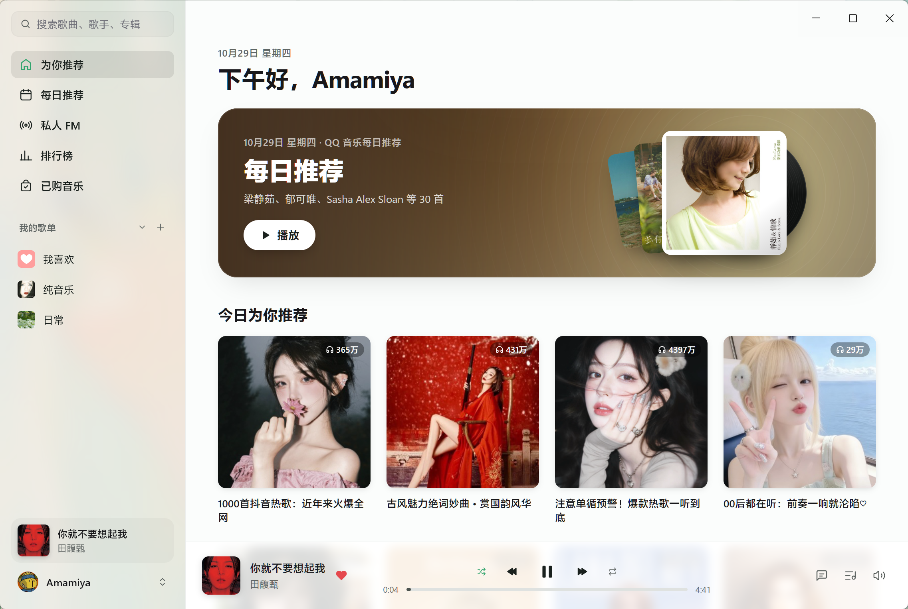

# Lilt

Lilt 是基于 MyGo 云音乐改造的第三方 QQ 音乐客户端，使用 Go 原生界面与播放器，以纯 Go 直接连接 QQ 音乐服务。


## 功能

- QQ / 微信扫码登录
- 每日推荐、推荐歌单、排行榜、我的歌单
- 已购单曲与数字专辑
- 搜索单曲、歌手、专辑，支持搜索联想
- 在线播放受支持的音乐
- LRC 歌词与同步翻译，正在播放页的「律动」视图与歌曲评论
- macOS 刘海播放器：在屏幕顶部刘海处显示迷你播放器，悬停展开
- 音量平衡模式，减小不同歌曲之间的音量差异

> 未登录可浏览和播放 QQ 允许匿名收听的歌曲。左下角「登录 QQ 音乐」可选择使用手机 QQ 或微信扫码。会员与版权权限由 QQ 音乐服务决定。

## 构建

需要 Go 1.27.3+，无需 C 工具链。

依赖已固定在 `vendor/`，包含 Windows 右键菜单文字裁切修复；重新生成依赖时请参照 [补丁说明](patches/README.md)。

```bash
go tool mygo dev     # 开发模式运行
go tool mygo build -platform windows/amd64  # 打包到 build/
go test ./internal/...                      # 运行测试
go tool mygo vet .
```

## 致谢

- [MyGo](https://github.com/egoist/mygo)：原生 UI 与应用框架
- [mygo-cloudmusic](https://github.com/egoist/mygo-cloudmusic)：网易云原生界面与播放器
- [qq-music-api](https://github.com/Rain120/qq-music-api)：提供登陆、个人内容获取、歌曲播放等
- [Linux DO](https://linux.do/) 社区

本项目与 QQ 音乐官方无关，音乐版权归各权利人所有。

## 许可证

[AGPL-3.0](LICENSE)
