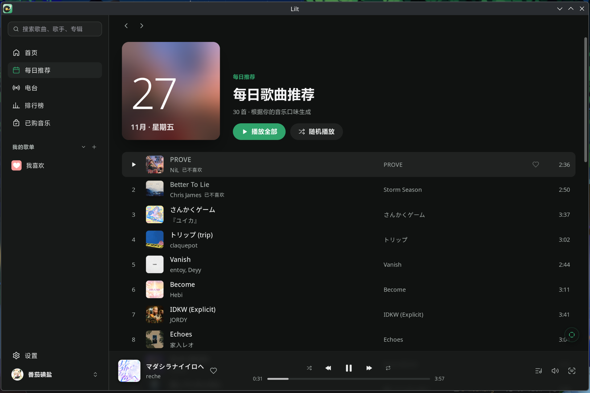
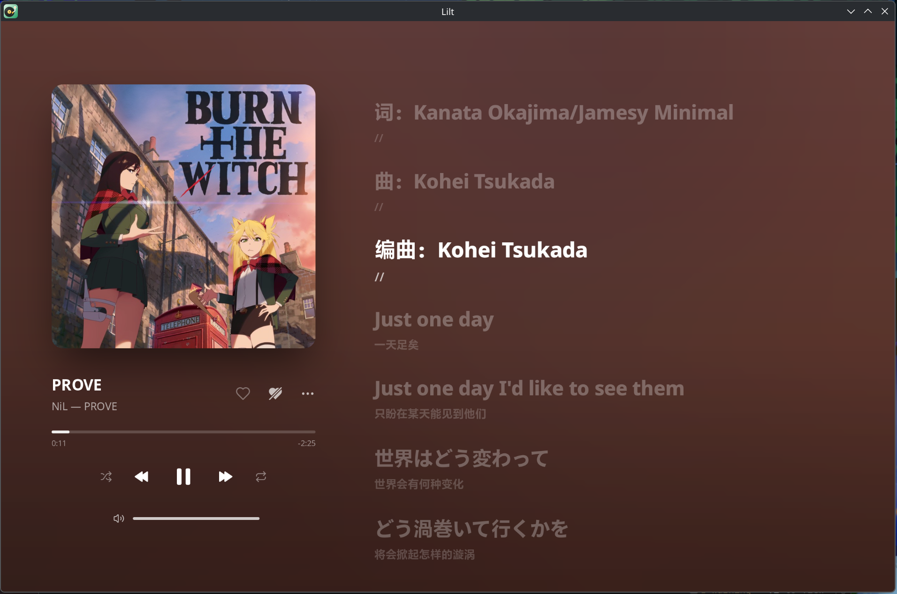

# 推荐歌曲「不喜欢」与每日推荐黑名单同步

登录 QQ 音乐后，你可以在 Lilt 中对「每日推荐」和「私人电台」里的歌曲标记「不喜欢」。该操作会把歌曲加入当前 QQ 音乐账号的歌曲黑名单。

## 标记「不喜欢」

1. 从「每日推荐」或「电台」开始播放，展开「正在播放」页。
2. 点击爱心右侧的**线框斜杠爱心**。QQ 音乐确认后，如果当前仍是这首歌，Lilt 会跳过它。
3. 已标记的歌曲仍会留在本次列表中，顺序和随机播放都会自动跳过它；如果想再听一遍，可以直接点击歌曲行手动播放。

如下图所示，`PROVE` 和 `Better To Lie` 在每日推荐列表中仍保留原位，歌名淡化，歌手名旁显示「已不喜欢」：

手动重听已标记的歌曲时，播放页的爱心右侧会显示**实心斜杠爱心**：

- 该图标仅用于展示状态，不可点击，手动重听也不会解除屏蔽。
- 歌曲在 Lilt 中显示为「已不喜欢」时，不能通过爱心把它加入「我喜欢」；已有收藏不会被自动移除。

## 重启后同步与生效范围

重启、升级或重装 Lilt 后，只要联网登录同一个 QQ 音乐账号，Lilt 就会在后台读取账号的歌曲黑名单：

- **恢复标记**：Lilt 从黑名单读到的歌曲，如果仍在**每日推荐**里，就会恢复「已不喜欢」标记，并在自动播放时跳过。
- **不打断播放**：同步在后台进行，不会打断正在播放的歌曲。
- **部分同步与失败处理**：只读到部分名单或请求失败时，Lilt 会保留本次运行中已确认的标记；重启后，尚未读到的歌曲可能暂时不显示标记。
- **适用范围**：黑名单的只读同步仅用于**每日推荐**，私人电台和普通歌单不会继承同步来的标记；私人电台仍可通过播放页的按钮手动标记「不喜欢」。

## 解除屏蔽

如需撤销反馈，可按以下步骤操作：

1. 在 QQ 音乐官方客户端的「黑名单设置」中移除该歌曲。
2. 重新进入 Lilt 的「每日推荐」。

待完整同步确认歌曲已移出黑名单后，Lilt 会清除对应的「已不喜欢」标记。解除屏蔽后，歌曲是否再次出现在每日推荐里，由 QQ 音乐决定。
